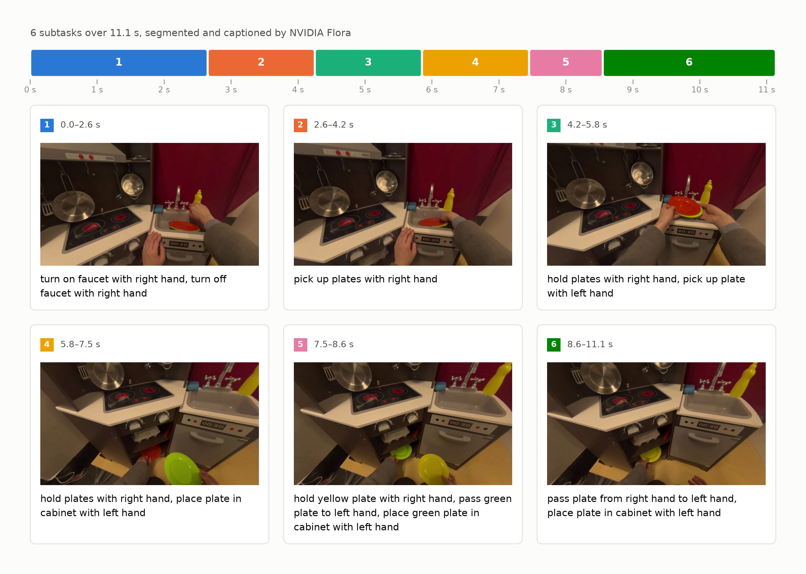

# flora-deploy

**Subtask, caption and reward labels for robot and human-demonstration videos, at dataset scale.**

For people training policies, VLAs or reward models on LeRobot-style data. flora-deploy runs
NVIDIA's [Flora](https://research.nvidia.com/labs/gear/flora/) models, which segment, caption and
score robot episodes, on [Modal](https://modal.com) GPUs in your own account. The code is
Apache-2.0; the Flora models are licensed by NVIDIA for **non-commercial research only**
([NOTICE](NOTICE.md)).



<sub>A public EgoDex episode, labeled with the default `balanced` preset.</sub>

- **Labels for your whole dataset.** Point it at a LeRobot dataset or a folder of MP4s and get
  every episode back labeled, as Parquet, JSONL or a labeled copy of your LeRobot dataset.
- **Priced before it runs.** `flora plan` estimates the cost; `flora run` stops at your budget.
- **`balanced` by default, `exact` as the reference.** `exact` runs NVIDIA's own code unchanged.
  `balanced` serves the same models with vLLM, on cheaper GPUs (L40S, H100 rather than H200).

| Stage | You get, per episode | Example |
|---|---|---|
| `segment` | subtasks, with start and end times | `0.0–2.6 s`, `2.6–4.2 s`, … |
| `caption` | a caption for each subtask | "pick up plates with right hand" |
| `reward.terminal` | did it succeed? A 1–5 score, with probabilities | `5` (expected `4.6`) |
| `reward.dense` | failure / suboptimal / normal (1–3) for every 0.5 s | `3, 3, 2, 3, …` |
| `reward.rubric` | a grade for each step of a rubric you write (experimental) | not yet run on a GPU ([limitations](docs/limitations.md)) |

**Why not just run NVIDIA's release?** It gives you the models and a reference pipeline; this adds
LeRobot and MP4 input, many GPUs in parallel, a budget cap, resume, and outputs keyed by episode.

## Try it in a few minutes (no GPU, no account)

The whole pipeline runs on your machine with stand-in models, so the captions are placeholders.
The demo uses the default `balanced` preset. You need Python 3.11+ and
[uv](https://docs.astral.sh/uv/).

```bash
uv tool install git+https://github.com/kaushikb11/flora-deploy
mkdir flora-demo && cd flora-demo
flora init --template local_demo                 # writes flora.yaml
flora run --local --fake-models --sample-data    # makes 6 sample videos and labels them
flora results caption
```

```text
no real run of local-demo; showing local-demo.fake, a fake-models run: these labels come from stand-in models, not Flora
local-demo.fake caption: 6 episodes, 18 subtasks
 uid            #  span        caption
 videos--ep000  0  0.0–0.8 s   push the bowl (task: pick up the red block)
```

The first line is expected: the demo's labels come from stand-in models, and every
`flora results`, `status` and `report` says so.

## Will it work on my data?

- **Input:** a LeRobot v2.1 or v3.0 dataset on the Hugging Face Hub, pinned to a commit, or a
  local folder (LeRobot, or one MP4 per episode).
- **Video:** MP4 or MOV (convert `.mkv`, `.webm`). Episodes under 120 s and 7,200 frames, at least
  4 fps, at most 4096 px and 256 MiB; cut longer recordings first. Episodes outside the limits run,
  flagged.
- **Cameras:** one view, or exactly three (`main`, `left_wrist`, `right_wrist`) in sync.
- **Rewards need task text** per episode (LeRobot task, a `.txt` per MP4, or one fixed text).
- **One `embodiment` per job** (run mixed datasets separately): `human` for egocentric human
  video (1 camera); `yam` for bimanual arms such as ALOHA ([example](examples/)) or one-camera
  robot video; `yam32` for `yam` with 32 s windows; `dex` or `tianji` for those robots (3 cameras).

## How it runs

Jobs run in the cloud: closing your laptop or pressing Ctrl-C doesn't stop them, and GPUs shut
down seconds after the work is done ([details](docs/modal.md)).

## Label your own data

You need a [Modal](https://modal.com) account; the `nvidia/Flora-*` models are public on Hugging
Face. Known-good config: [`examples/lerobot_small`](examples/lerobot_small).

```bash
modal setup                 # once per machine
mkdir my-labels && cd my-labels
flora init                  # writes flora.yaml; set input.repo and input.revision
flora doctor                # checks your setup; free
flora prepare               # once: downloads the models (about 185 GB, CPU only, about $0.12)
flora index                 # scans every episode; a few cents
flora plan                  # cost and wall-clock options; free
flora deploy                # once per config
flora run                   # labels the dataset, streaming progress
flora results caption       # or segment, reward.terminal, reward.dense
flora export --to lerobot --out ./my-dataset-flora --include-videos --allow-uncertified \
    --push-to-hub me/my-dataset-flora   # labeled copy to a new private repo (hf auth login)
```

`input.revision` is a full commit; Hub datasets must be public ([private data](docs/modal.md)).
Export adds `flora_subtasks` and `flora_terminal_score` per episode, `flora_dense_reward` and
`flora_subtask_index` per frame; push to a new repo, not the source ([details](docs/export.md)).

## Cost

<!-- wave-h:cost -->
| Video | Segment + caption | + rewards | Wall-clock |
|---|---|---|---|
| 3 min (0.05 h) | $1.05 | $1.79 | 9 min |
| 1 h | $6.07 | $7.85 | 57 min |
| 10 h | $53.65 | $65.25 | 8.6 h |

All-in estimates at Modal list prices: one-minute, single-camera episodes, one GPU per stage.
The real cost can land about 35% below to 60% above.
<!-- /wave-h:cost -->

Small jobs mostly pay for GPU startup; `max_gpus: 10` cuts 10 h of video to about 1.3 h for about
7% more. `flora plan` prices your own dataset ([`docs/costs.md`](docs/costs.md)).

## Configuration

```yaml
# flora.yaml (flora init writes a fully commented one): the settings you'll change
project: my-labels
license_ack: research-only        # required
preset: balanced                  # or exact: NVIDIA's own code, unchanged, on an H200
allow_uncertified: true           # required for balanced today (see the note below)
modal:
  budget_usd: 25                  # hard cap for this job
  max_gpus: 4                     # more GPUs finish sooner; each pays startup
input:
  format: lerobot_v3              # lerobot_v21 | lerobot_v3 | mp4_dir
  repo: your-org/your-dataset
  revision: <full commit sha>     # pinned, so a rerun labels the same data
pipeline:
  stages: [segment, caption, reward.terminal, reward.dense]
  embodiment: human               # see "Will it work on my data?"
output:
  sink: volume://flora-results/my-labels   # or s3://bucket/prefix
```

<!-- wave-h:allow-uncertified -->
**Note:** `balanced` segment and caption records currently say `certified: false`, so they need
`allow_uncertified: true` here and `--allow-uncertified` when you export.
<!-- /wave-h:allow-uncertified -->

**Budget.** Before each piece of work, flora-deploy projects the job's total spend. Past 95% of
`budget_usd` it starts nothing new (`budget_stopped`, exit code 4), and it cancels work in flight
that would pass the cap. `flora resume --budget-usd 50` raises the cap and carries on.

## Using the labels

```python
# flora results caption --format parquet --out caption.parquet
# flora results reward.terminal --format parquet --out terminal.parquet
import pandas as pd                                  # pip install pandas pyarrow

captions = pd.read_parquet("caption.parquet")        # one row per subtask
scores = pd.read_parquet("terminal.parquet")         # one row per episode
labels = captions.merge(scores[["uid", "terminal_score"]], on="uid")
```

Join on `uid` (the episode); Parquet flattens JSONL's `terminal.score` to `terminal_score`.
[All fields](docs/output-format.md) · [Python API](docs/python.md)

## Status

Version 0.0.1, pre-release (GitHub only, Python 3.11+). [Limitations](docs/limitations.md) ·
[CLI reference](docs/cli.md) · [Issues](https://github.com/kaushikb11/flora-deploy/issues)
